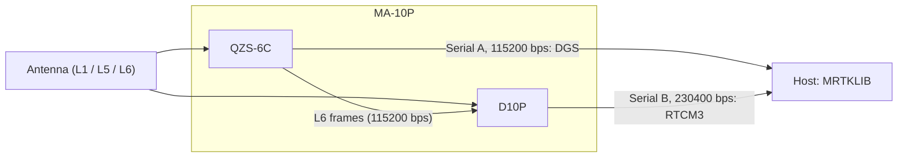

# CLAS Positioning with DATAGNSS MA-10P

!!! warning "Status"
    Real time (`mrtk run`) is tested and works. Post-processing fixes at wrong
    positions on this receiver's data
    ([#585](https://github.com/h-shiono/MRTKLIB/issues/585)), and there is no
    bundled configuration yet: the signal list needs a placeholder
    ([#584](https://github.com/h-shiono/MRTKLIB/issues/584)).

This guide describes how to use a **DATAGNSS MA-10P** as the observation and
correction source of MRTKLIB's CLAS PPP-RTK engine, in post-processing
(`mrtk post`) and in real time (`mrtk run`).

The receiver used for this guide was provided by DATAGNSS. The tests and the
statements on this page are those of the MRTKLIB project.

## Overview

### MA-10P

The [MA-10P](https://docs.datagnss.com/gnss/rtk_receiver/MA-10P/) is a low-cost
receiver for the QZSS correction services. It holds two GNSS modules behind one
antenna input and a four-port USB serial bridge:

| Module | Role | Output used here |
|--------|------|------------------|
| **D10P** | L1 + L5 multi-GNSS receiver with its own PPP engine | RTCM3 MSM7 observations and ephemerides |
| **QZS-6C** | QZSS L6 receiver | L6 frames in the **DGS** format |



According to the vendor's block diagram, the receiver's own engine takes the
L6 frames from the QZS-6C internally and reports its solution as NMEA. MRTKLIB does not use that solution: it reads the
two modules separately and computes the position on the host.

| USB serial port | Module | Baud rate | Content |
|-----------------|--------|-----------|---------|
| Serial A | QZS-6C | 115200 | DGS L6 frames, RTCM3 1058 |
| Serial B | D10P | 230400 | RTCM3 (see below) |
| Serial C, D | — | — | not connected |

### What was tested

| Item | Status |
|------|--------|
| Hardware | MA-10P v1 (USB serial bridge `1a86:55d5`, four ports) |
| L6 signal | **L6D (CLAS)**: PRN 195 and 199 on this unit, PRN 194 / 195 / 196 in the vendor's dataset |
| L6E (MADOCA-PPP) | not tested on this unit. Tested by the vendor on an MA-10P with the L6E firmware ([#579](https://github.com/h-shiono/MRTKLIB/pull/579#issuecomment-7153618005)); their five-minute capture decodes here as well (`mrtk l6extract`, Float PPP in `mrtk post` and in a `mrtk run` replay), with observations from the vendor's file, not from this unit |
| Post-processing | `mrtk l6extract` → `mrtk post` runs, but the Fix positions are wrong (see Known Issues) |
| Real time | `mrtk run` on the two serial ports of this unit: PPP-RTK Float. Replay of the vendor's open-sky dataset: Fix, see Test Results |

!!! note "MA-10P v2"
    According to the vendor, the MA10P-V2-CLAS model can output the RTCM3
    stream. It has not been tested with MRTKLIB yet.

## Data from the Receiver

### Observations and ephemerides (Serial B)

The D10P port carried RTCM3 only, with these messages every second:

| Messages | Content |
|----------|---------|
| 1077, 1087, 1097, 1117, 1127 | MSM7: GPS, GLONASS, Galileo, QZSS, BeiDou |
| 1019, 1020, 1042, 1044, 1046 | Ephemerides: GPS, GLONASS, BeiDou, QZSS, Galileo I/NAV |

| Constellation | Signals (RINEX codes) |
|---------------|-----------------------|
| GPS | L1 C/A (`1C`), L5 (`5Q`) |
| GLONASS | L1 C/A (`1C`) |
| Galileo | E1 (`1X`), E5a (`5Q`) |
| QZSS | L1 C/A (`1C`), L5 (`5Q`) |
| BeiDou | B1I (`2I`), B1C (`1P`), B2a (`5P`) |

The existing RTCM3 decoder reads this stream as it is. CLAS augments GPS,
Galileo and QZSS, so GLONASS and BeiDou are not used in PPP-RTK.

### L6 frames (Serial A): the DGS format

DGS is the vendor's name for one message of the Allystar binary protocol,
described in the vendor's
[DGS Format Notes](https://gist.github.com/datagnss/af7013746c3776a2f5e1cebb9cabdb6c).
Each message carries one 250-byte L6 frame:

| Offset | Size | Field |
|-------:|-----:|-------|
| 0 | 4 | `F1 D9 02 10` (sync, message group and id) |
| 4 | 2 | payload length = 264, little-endian |
| 6 | 2 | 700 + L6 PRN, little-endian |
| 8 | 1 | frequency id |
| 9 | 1 | data length in words + 2 = 65 |
| 10 | 2 | GPS week, **big-endian** |
| 12 | 4 | time of week (ms), **big-endian** |
| 16 | 1 | signal strength |
| 17 | 1 | status flags: `0x01` Reed-Solomon failed, `0x02` week not confirmed, `0x04` time of week not confirmed |
| 18 | 252 | L6 frame (250 bytes, preamble first) + 2 padding bytes |
| 270 | 2 | 8-bit Fletcher checksum over bytes 2–269 |

Points seen on the receiver that the format notes do not cover (the byte
order, the flag names, the L6E frame and the hourly flag were confirmed by the
vendor):

- Bytes 8–15, reserved in the notes, hold the frequency id, the data length,
  the GPS week and the time of week, as in the QZS-6C datasheet.
- The week and time of week are big-endian, unlike the rest of the container.
- The status flags are named as in the datasheet (`0x02` week, `0x04` time of
  week), not as in the notes.
- The L6 block holds L6D frames or L6E ones, depending on the firmware; the
  frame is the same.
- The receiver sends one frame per second **for each tracked L6 PRN**. The two
  PRNs seen here carried the same CLAS transmit pattern, so the second one is
  a spare, not a second pattern.
- In the captures of this unit the port also carried, between the frames, an
  RTCM3 1058 message (GPS clock corrections) with a valid CRC every five
  seconds. MRTKLIB skips everything that is not a DGS frame.
- At every top of the hour the receiver flags a Reed-Solomon failure on one
  frame per PRN. Frames with any status flag set are dropped, so one frame per
  PRN is lost each hour.

`mrtk` routes each frame by its L6 header, as for the u-blox and Septentrio L6
messages: CLAS, MADOCA-PPP, or MADOCA-PPP ionosphere.

## Equipment

| Component | Description |
|-----------|-------------|
| **DATAGNSS MA-10P** | CLAS model (L6D firmware in the QZS-6C) |
| **GNSS antenna** | Multi-band antenna covering L1, L5 and **L6** |
| **Host PC / SBC** | Linux or macOS machine with MRTKLIB built |

## Setting Up the Receiver

The USB bridge appears as four serial devices. On macOS they are
`/dev/cu.usbmodem<serial>1`, `…3`, `…5` and `…7` for Serial A to D, and no
driver is needed; always use the `cu.*` names, not `tty.*`.

The D10P port must output RTCM3 MSM7 and ephemerides instead of the default
NMEA. The receiver used here had been switched with
[Satrack](https://docs.datagnss.com/common/common_satrack_guide/), the vendor's
Windows utility. The steps below follow its manual, with the messages this
receiver was sending:

1. Connect Satrack to Serial B at 230400 bps.
2. **Receiver → Set RTCM Rate**: set the MSM7 messages (1077, 1087, 1097, 1117,
   1127) and the ephemerides (1019, 1020, 1042, 1044, 1046) to 1 s.
3. **Receiver → Set NMEA Rate**: set the NMEA messages to 0 to turn them off.
4. Click **Save**.

The same settings exist as binary commands on the vendor's
[Common RTK Commands](https://docs.datagnss.com/common/common_cmds_for_rtk/)
page; they were not tried here. With NMEA turned off, the solution of the
receiver's own engine is no longer output on this port.

Nothing has to be configured on the QZS-6C port. It sent DGS frames whenever an
L6 signal was tracked and was silent in a capture with weak signals.

## Post-processing

!!! warning
    `mrtk post` currently fixes at wrong positions on this receiver's data
    ([#585](https://github.com/h-shiono/MRTKLIB/issues/585)). Use the real-time
    path, or replay the logged files with `mrtk run`, until it is resolved.

Log the two ports with `mrtk relay`. The first few seconds after a port is
opened can be out of order, so start a little early.

```bash
# Terminal 1: observations and ephemerides
mrtk relay -in serial://cu.usbmodem01234567893:230400 \
  -out "file://ma10p.rtcm3::T"

# Terminal 2: L6 frames
mrtk relay -in serial://cu.usbmodem01234567891:115200 \
  -out "file://ma10p.dgs::T"
```

Then convert and process:

```bash
# RTCM3 -> RINEX (give the approximate start time of the log)
mrtk convert -r rtcm3 -tr 2026/11/24 07:00:00 -o ma10p.obs -n ma10p.nav ma10p.rtcm3

# DGS -> one file per L6 PRN: ma10p.195.l6d, ma10p.199.l6d, ...
mrtk l6extract -r dgs -o ma10p ma10p.dgs

# CLAS PPP-RTK
mrtk post -k <conf> -o ma10p.pos ma10p.obs ma10p.nav ma10p.195.l6d ma10p.199.l6d
```

The logged files can also be replayed in real time: set the two input streams
to `type = "file"`, with paths `ma10p.rtcm3::T` and `ma10p.dgs::T`.

## Real Time

`mrtk run` reads both ports directly. The rover stream is `rtcm3`, the
correction stream is `dgs`:

```toml
[streams.input.rover]
type = "serial"
path = "cu.usbmodem01234567893:230400:8:n:1:off"
format = "rtcm3"

[streams.input.correction]
type = "serial"
path = "cu.usbmodem01234567891:115200:8:n:1:off"
format = "dgs"
```

```bash
mrtk run -s --config <conf>
```

## Configuration

There is no bundled `conf/claslib/` file for the MA-10P yet. Start from
`conf/claslib/rtkrcv_rtcm3_ubx.toml` with the two streams above, an empty rover
antenna type (`[antenna.rover] type = ""`), `gps_frequency` / `qzs_frequency`
left unset, and this signal list (layout from the vendor's test):

```toml
[positioning]
signals = ["G1C", "G5Q", "E1X", "E7Q", "E5Q", "J1C", "J5Q"]
```

The list fills the observation slots of each constellation in order, and the
CLAS PPP-RTK engine takes the second frequency from a fixed slot:

- GPS and QZSS: slot 1 by default, which holds L5 here. `gps_frequency =
  "l1+l5"` selects slot 2 instead, which is empty with this list, so those
  keys must stay unset.
- Galileo: slot 2 only. `E7Q` is not output by the receiver; it is listed to
  push `E5Q` into slot 2. Without it Galileo runs on E1 alone.

This placeholder is a workaround, not the intended interface
([#584](https://github.com/h-shiono/MRTKLIB/issues/584)). The test
configuration `tests/data/ma10p_dgs/rtkrcv_dgs_clas.toml.in` is a complete
example.

## Test Results

Vendor dataset (30 min, static, open sky, 2026-11-25, DGS L6D of PRN 194 / 195 /
196 and the D10P RTCM3), replayed through `mrtk run` with `format = "dgs"`;
the vendor's numbers were reproduced here on the same build:

| Item | Result |
|------|--------|
| Fix / Float / Single | 1412 / 344 / 44 epochs (Fix 78.4 %) |
| First Fix | 16 s |
| Satellites used | 15 to 18 |
| Fixed solutions vs the known antenna position | mean E +3.5, N −1.9, U −4.8 cm; horizontal 68 % / 95 %: 4.6 / 16.6 cm |

The run is not clean: about 3.5 minutes of Fix sit 17 cm off in north, and the
last 5.5 minutes stay Float. The cause is not investigated.

The dataset is published as `ma10p_dgs-v1` in
[h-shiono/mrtklib-data](https://github.com/h-shiono/mrtklib-data/releases/tag/ma10p_dgs-v1).
The regression test `rtkrcv_rt_dgs_clas` replays its first five minutes
through `format = "dgs"`: Fix / Float / Single 285 / 5 / 11, first Fix after
16 s.

## Known Issues

- **`mrtk post` gives wrong Fix positions on this receiver's data.** On the
  vendor dataset, the same build and settings that give centimetre-level Fix
  in `mrtk run` give Fix solutions 0.3 to 2 m off in `mrtk post` (RINEX from
  `mrtk convert`, L6 from `mrtk l6extract`). Use the real-time path until
  this is resolved ([#585](https://github.com/h-shiono/MRTKLIB/issues/585)).
- **The first capture of the unit used for this guide did not give a usable
  Fix.** Five minutes under a partly blocked sky, six to seven satellites
  used: Fix on 135 of 301 epochs with the layout above, but those solutions
  scatter by more than a metre. An earlier trial with `gps_frequency` /
  `qzs_frequency` = `"l1+l5"` ran every satellite on L1 alone and stayed Float.
- **MADOCA-PPP not tested on this unit.** Only the CLAS (L6D) firmware was
  available. The vendor tested the L6E firmware (see the table above): the
  receiver then sends the tracked L6E PRNs interleaved, one frame per second
  each. MADOCA-PPP with the D10P's own L1 + L5 observations is not validated.
- **`mrtk dump` does not accept `.l6d`.** Rename the file to `.l6` to inspect
  the decoded CSSR.
